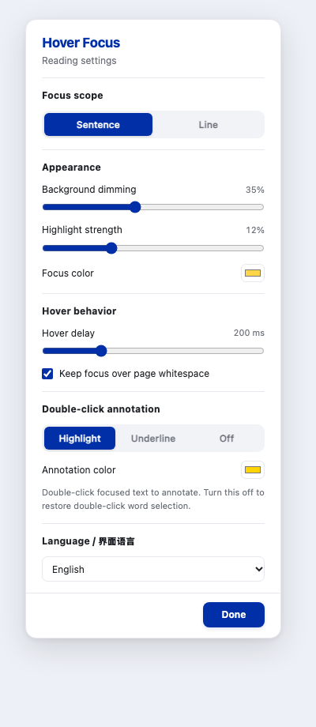

# Hover Focus

**A Zotero PDF reader plugin for hover-based sentence and line focus.** Keep the text under your pointer clear, dim surrounding content, and optionally save native annotations with a double-click.

**Zotero 悬停聚焦阅读插件：**鼠标停在整句或整行上时保持当前内容清晰，其余正文变暗；可选双击保存高亮或下划线，支持中英双语界面。

[English guide below](#install) · [简体中文完整说明](README.zh-CN.md)

## Features

- Hover to focus on a sentence or visual line.
- Adjustable background dimming, highlight color and strength, and hover delay.
- Optional double-click to save a native Zotero highlight or underline.
- A compact icon in the middle toolbar group; right-click to open settings.
- English and Simplified Chinese interfaces, with an automatic Zotero-language option.
- Reading assistance runs locally, without AI services, accounts, or uploading document text.

## Install

This is an **early preview**, targeting Zotero 10 desktop. Download [`hover-focus-0.3.1.xpi`](https://github.com/lllumos-luo/zotero-hover-focus/releases/download/v0.3.1/hover-focus-0.3.1.xpi) from the [Releases page](https://github.com/lllumos-luo/zotero-hover-focus/releases). In Zotero, choose **Tools → Plugins → gear menu → Install Plugin From File**, then select the XPI.

## Quick start

| Action | Result |
| --- | --- |
| Click the blue Hover Focus icon in the PDF toolbar | Toggle focus mode; hover over the icon to check its state |
| Hover over PDF body text | Focus the sentence or line after the configured delay |
| Right-click the icon | Open settings; Option/Control/Command-click also works |
| Choose Sentence / Line | Change the focus unit |
| Adjust background dimming and highlight strength | Tune the effect; either may be set to zero |
| Double-click already focused text | Save a native Zotero annotation, if enabled |
| Choose Highlight / Underline / Off | Configure or disable double-click annotation |
| Select text or scroll | Temporarily remove the focus effect |
| Choose Language | Follow Zotero, use 简体中文, or use English immediately |

Hovering creates a temporary visual focus, not a saved annotation. Only the optional double-click gesture saves a highlight or underline, which can be undone through Zotero. Reopen the PDF tab if the icon is missing after an update.

## Preview

These images show the actual settings renderer in a standalone browser, rather than a screenshot of Zotero.



## Compatibility and limitations

- Developed against Zotero 10.0.7 and tried by the author on macOS. Windows and Linux have not been tested.
- Requires a PDF with extractable text. Reflowed Reading Mode, EPUB, Preview.app and the secondary split view are not supported.
- Sentence detection can be imperfect for unusual references, equations, layout or OCR. A sentence crossing a page boundary is split at that boundary.
- Double-click annotation uses the same gesture as word selection. Other plugins, including AI4Paper, may react before annotation completes; this interaction has not been comprehensively tested.
- Hover itself creates no permanent annotation. Explicit double-click annotations use Zotero’s normal save and undo flow. This plugin does not assign AI4Paper semantic tags.
- Internal reader APIs may change with Zotero updates.

## Build and checks

Requires Node.js with `Intl.Segmenter` and Python 3. No npm packages are needed.

```sh
node --test tests/*.test.cjs
node --check bootstrap.js
node --check ui.js
python3 build.py
```

The installable file is written to `dist/`. Tests use a simulated reader and do not replace testing in Zotero. Two checks that inspect locally installed Zotero source skip when that source is unavailable. Open `preview.html` or `preview.html?lang=en` to preview the shared UI renderer.

## Updates

Updates are configured through [`updates.json`](updates.json), hosted in this repository. Once the release asset and update manifest are published, Zotero can check for updates. Future releases must update this file to match the version, download URL and SHA-256 hash generated by `python3 build.py`. Builds installed before this endpoint was configured require one manual installation of v0.3.1 or later. No document text is uploaded by the reading features.

## Maintenance

This is a personal tool, maintained when time allows. Response times, new features and compatibility with every platform or Zotero version are not guaranteed. Reproducible bug reports and pull requests are welcome. Please include your Zotero version, operating system, other reading plugins, and steps to reproduce. Use a public sample document where possible.

## License

MIT. See [LICENSE](LICENSE).
