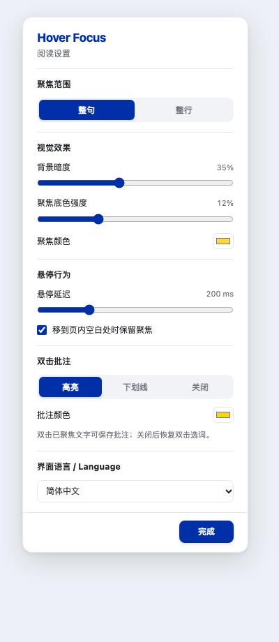

# Hover Focus

**Zotero 悬停聚焦阅读插件：**鼠标停在整句或整行上时保持当前内容清晰，其余正文变暗；可选双击保存高亮或下划线。

A Zotero PDF reader plugin for hover-based sentence and line focus, with adjustable dimming and optional annotations.

[English](README.md)

## 功能

- 整句／整行悬停聚焦。
- 可调背景暗度、聚焦颜色、底色强度与悬停延迟。
- 可选双击保存为 Zotero 原生高亮或下划线。
- 中间工具组的蓝色图标，右键打开设置面板。
- 简体中文／English／跟随 Zotero，手动切换立即生效。
- 阅读辅助在本地运行，不需要 AI 服务、账号，也不上传文献正文。

## 安装

当前为 **早期试用版**，面向 Zotero 10 桌面端。从 [Releases 页面](https://github.com/lllumos-luo/zotero-hover-focus/releases) 下载 [`hover-focus-0.3.1.xpi`](https://github.com/lllumos-luo/zotero-hover-focus/releases/download/v0.3.1/hover-focus-0.3.1.xpi)。在 Zotero 中选择 **工具 → 插件 → 齿轮 → 从文件安装插件**。

## 快速使用

先打开 PDF 的原始页面视图。

| 操作 | 效果 |
| --- | --- |
| 单击工具栏蓝色 Hover Focus 图标 | 开启／关闭聚焦；悬停图标查看状态 |
| 鼠标停在正文上 | 等待设定时间后聚焦当前句或行 |
| 右键图标 | 打开设置；Option／Control／Command 加单击也可打开 |
| 选择“整句／整行” | 更改聚焦范围 |
| 调整背景暗度、底色强度 | 自定义视觉效果，两项均可调至 0 |
| 双击已经聚焦的文字 | 启用此功能时，保存原生 Zotero 批注 |
| 选择“高亮／下划线／关闭” | 设置或关闭双击批注 |
| 选中文字或滚动 | 暂时撤下聚焦效果 |
| 切换“界面语言” | 跟随 Zotero、简体中文或 English，即时生效 |

悬停只产生临时视觉效果，不会保存高亮。主动双击才创建批注，可经 Zotero 撤销。若需保留原有双击选词翻译，可关闭“双击批注”。更新后未见图标时，关闭并重新打开 PDF 标签页。

## 界面预览

下图由插件实际设置渲染代码在独立浏览器中生成，并非 Zotero 内截图。



## 支持范围与限制

- 按 Zotero 10.0.7 开发，作者在 macOS 上试用；Windows 和 Linux 尚未验证。
- 需要可提取文字的 PDF。不支持重排阅读模式、EPUB、macOS Preview 或第二分栏视图。
- 复杂引用、公式、版式或 OCR 可能导致断句不准；跨页句子按页面分开。
- 双击批注与双击选词使用相同手势。AI4Paper 等插件可能先触发选词动作，联合兼容性尚未全面验证；可关闭双击批注。
- 悬停不创建永久批注。主动双击时经 Zotero 正常流程保存，可使用撤销操作撤回；不会添加 AI4Paper 语义标签。
- Zotero 内部阅读器接口升级时可能需要适配。

## 构建与检查

需要支持 `Intl.Segmenter` 的 Node.js 与 Python 3，无需安装 npm 依赖。

```sh
node --test tests/*.test.cjs
node --check bootstrap.js
node --check ui.js
python3 build.py
```

安装包输出到 `dist/`。测试包含模拟阅读器检查，不等同于 Zotero 实机测试；依赖本机 Zotero 源码的两项检查在源码不可用时会跳过。打开 `preview.html` 或 `preview.html?lang=en` 可预览实际面板渲染代码。

## 更新

更新配置位于本仓库的 [`updates.json`](updates.json)。上传更新清单并发布对应安装包后，Zotero 可通过该地址检查更新。以后发布新版时，运行 `python3 build.py` 会生成版本号、下载地址及 SHA-256 匹配的更新清单，需要与新版本同步上传。使用早期占位更新地址的旧版用户，需要先手动安装一次 v0.3.1 或之后的版本。阅读功能不会上传文献正文。

## 维护

这是一个首先服务于作者自身阅读需要的个人项目，按个人时间维护，不承诺响应时间、新功能或全部平台兼容性。欢迎提交可复现问题和改进代码。反馈请包含 Zotero 版本、系统、其他阅读插件及复现步骤，尽量使用公开示例文献。

## 许可证

MIT，见 [LICENSE](LICENSE)。
